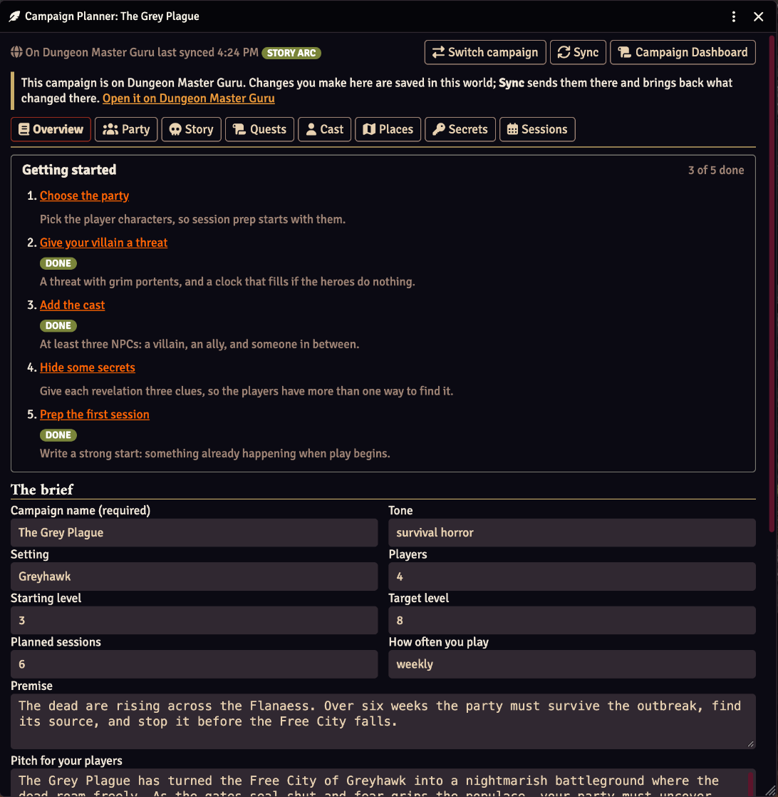
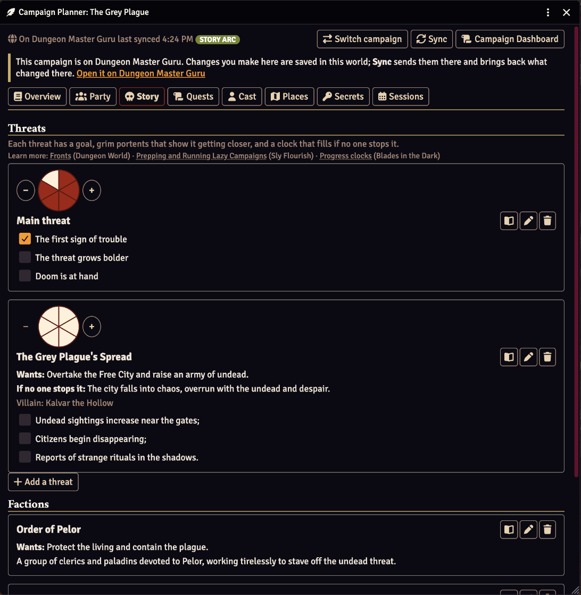
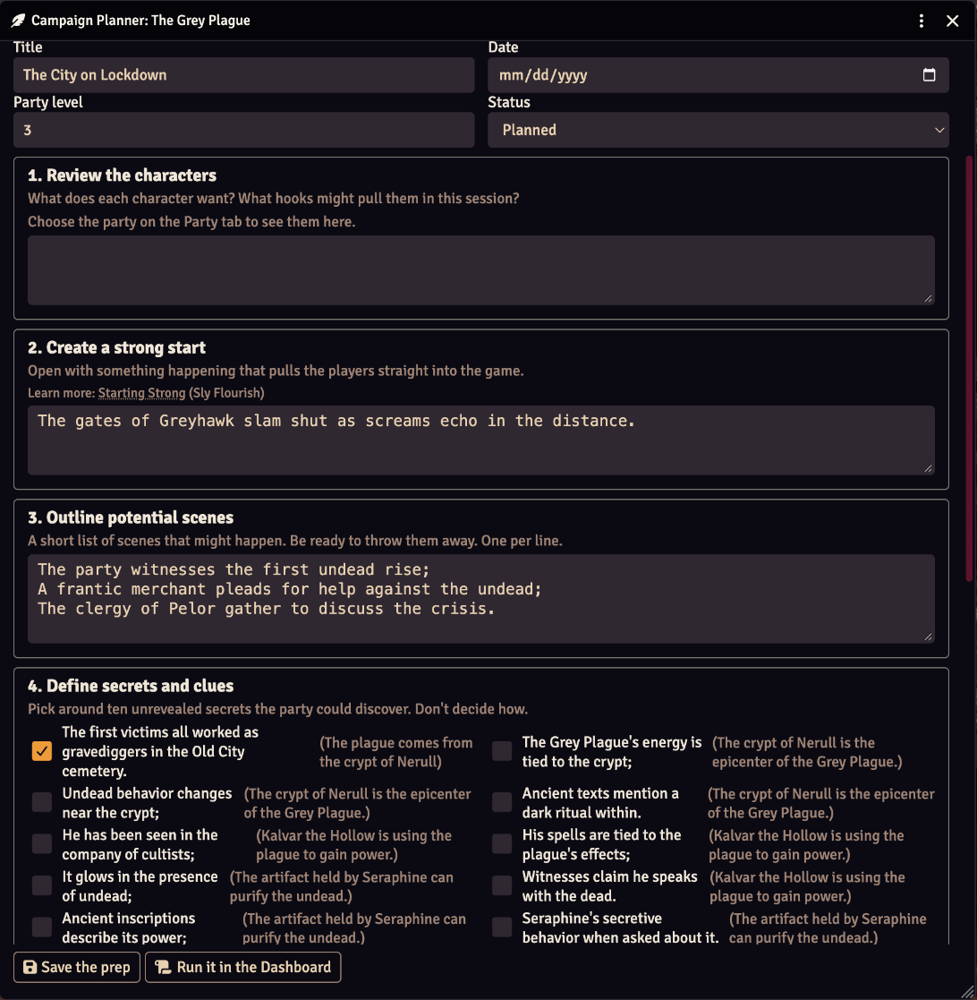
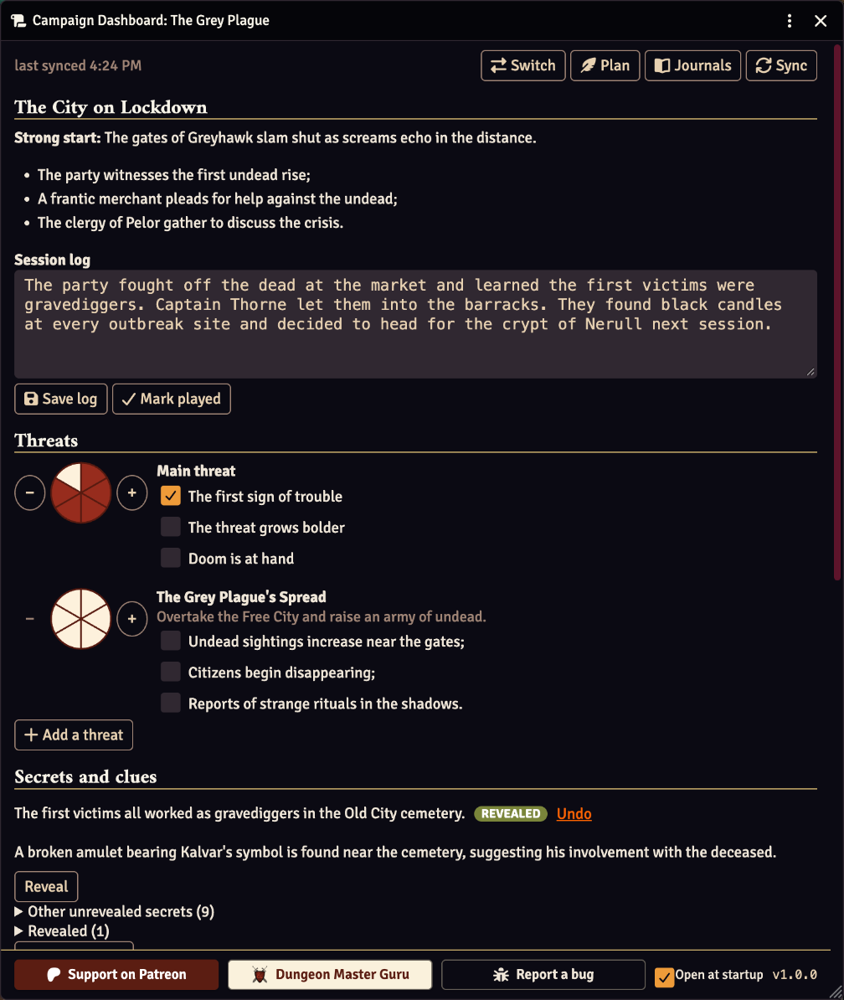
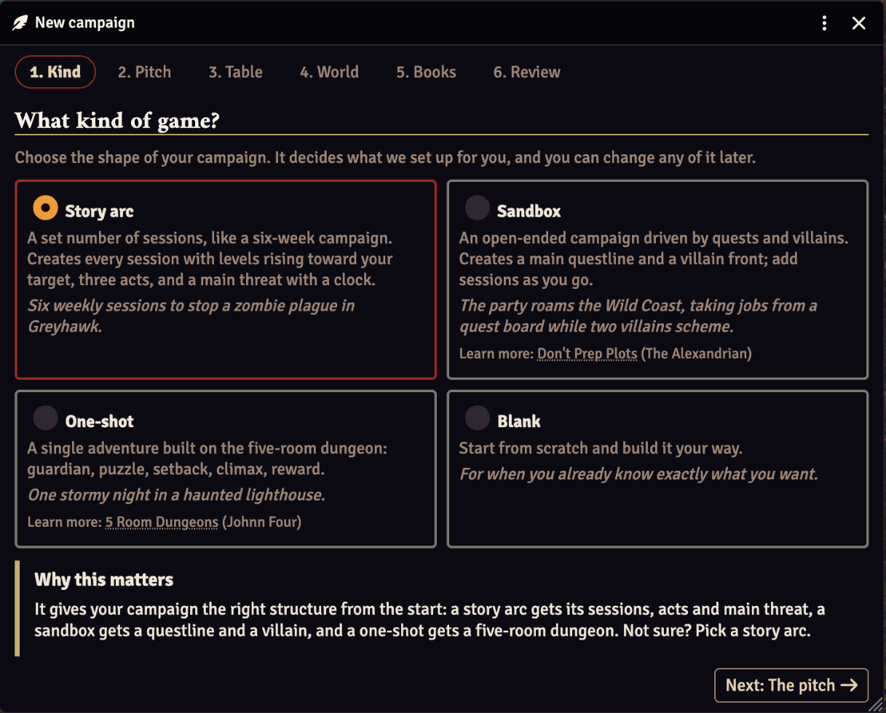
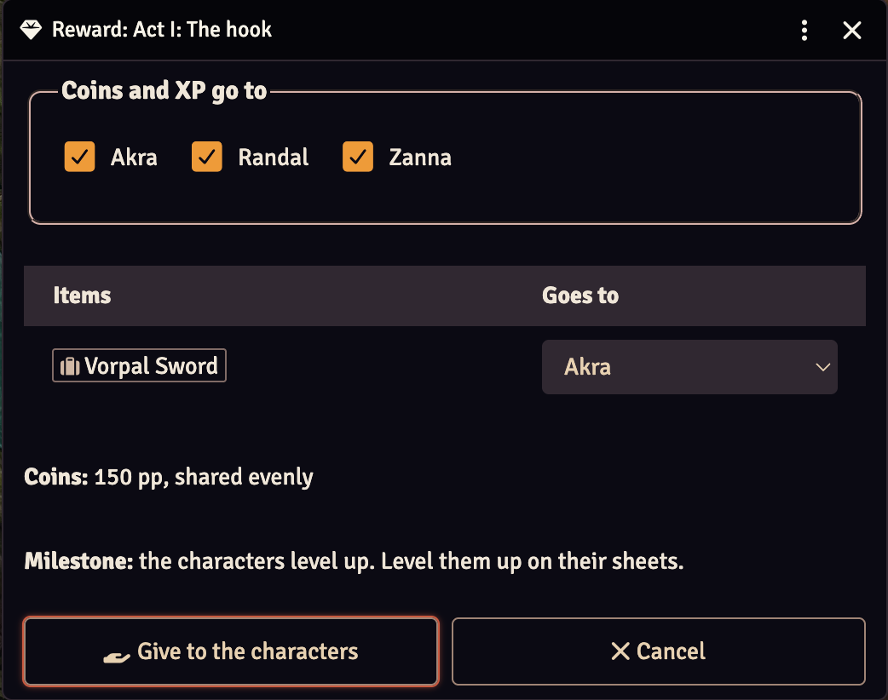

# Dorman Lakely's Campaign Planner

Plan a campaign the Lazy Dungeon Master way, right in Foundry VTT, and run it at the table from the Campaign Dashboard. No account needed. To plan from anywhere, even with Foundry closed, connect to [Dungeon Master Guru](https://dungeonmaster.guru) and plan there too.

## Screenshots

| | |
|---|---|
|  |  |
| **Campaign Planner.** The brief and a Getting started checklist. | **Story.** Threats with clocks and grim portents. |
|  |  |
| **Session prep.** The eight steps, one card each. | **Campaign Dashboard.** What you need at the table. |
|  |  |
| **New campaign guide.** Six short steps. | **Give the reward.** Items, coins and XP to the characters. |

## Two ways to plan

**In your world (free, no account).** Click **New** in the Journal sidebar. A step-by-step guide walks you through what kind of game, the pitch, your table (party, levels, sessions), the world and its truths, and your books, explaining why each step matters. Click **Create in this world**, and you get:

- **Journals:** a folder for the campaign with an entry for each part of it: Overview, Sessions, Cast, Threats, Quests, Secrets and Clues, Places, Factions and Book References. Each record is its own page, visible to the GM only until you share it. A story arc starts with its sessions, three acts and a main threat; a sandbox with a villain and a questline; a one-shot with a five-room dungeon.
- **Campaign Planner:** a tab for each part of the campaign, with editing, a Three Clue Rule check, eight-step session prep, and a plan for each quest: its maps, NPCs, monsters and reward. Drag monsters, items and roll tables in from your compendiums.
- **Campaign Dashboard:** your at-the-table view.
  - The next session and its log.
  - Threat clocks you can advance, and grim portents you can tick off.
  - Secrets and clues to reveal.
  - Quests and their status, with an active quest's maps, monsters and reward.
  - **Give the reward:** hand a quest's reward or a session's treasure to the characters (items to whoever you choose, coins shared evenly, XP shared or given to each), with a summary in chat. With [Item Piles](https://foundryvtt.com/packages/item-piles) set up for your system, you can leave it on the scene as an item pile instead.
  - Add threats, secrets, quests, NPCs, places, factions and sessions as you go.

- **Export as an Adventure:** pack the campaign's journals, maps and actors into a Foundry Adventure in a world compendium, to import into another world with Foundry's Adventure importer. There it opens as a campaign of its own.

**On Dungeon Master Guru (free account).** Plan on the website as well as in Foundry. It adds:

- **Plan from anywhere:** the same planner on the website, from any computer or phone, even with Foundry closed.
- **Two-way sync:** the campaign comes into your journals, and what you change in Foundry goes back. Changes are saved in your world straight away; **Sync** at the top of the Campaign Planner and Dashboard sends them and brings back the website's. If Dungeon Master Guru can't be reached, they wait for the next Sync. If the same thing changed in both places, you choose which to keep.
- **Your compendiums:** the module sends Dungeon Master Guru the index of your SRD 5.2 compendiums and the 2024 Player's Handbook, Dungeon Master's Guide and Monster Manual modules you own: names, challenge ratings and IDs, never stat blocks or book text. Monsters and treasure you pick while planning become links in your session journals. Drag one onto a scene to place a token.
- **Your party:** your world's Player Character actors and their sheets, for prep on the website. Spell, feature and item descriptions stay in Foundry.
- **Your maps** (with sync): a thumbnail of each scene in your world, so you can pick maps on the website and see them while Foundry is closed.

The **How it works** window (the **?** button in the Journal sidebar) explains both, step by step. It opens once the first time a GM loads the module.

## Finding things

The Journal sidebar has the Campaign Planner's buttons, for the GM only:

| Button | What it does |
|---|---|
| **Plan** | Opens the Campaign Planner: Overview, Party, Story, Quests, Cast, Places, Secrets and Sessions, with the Lazy Dungeon Master's eight steps of session prep. Drag monsters, items and roll tables in from your compendiums. |
| **Run** | Opens the Campaign Dashboard, for the table. Also in the scene controls, under Journal Notes. It opens by itself when the world loads; untick **Open at startup** in its footer to stop that. |
| **New** | Starts a new campaign, step by step. Your answers are kept as you go. |
| **Switch** | Switches to another campaign: one in this world, or one on Dungeon Master Guru when you're connected. Also at the top of the Campaign Planner and Dashboard. |
| **?** | How it works. |

## Connecting to Dungeon Master Guru

1. Make a free account at [dungeonmaster.guru](https://dungeonmaster.guru).
2. In Foundry, open **Settings → Module Settings → Dorman Lakely's Campaign Planner → Connect**, or the Dashboard's menu, and click **Get a code**.
3. Enter the code on Dungeon Master Guru (the window links to the page); Foundry connects by itself. You can also paste an API token from **Dashboard → Connections → API tokens** instead.
4. Link a campaign, create one with **New** → **Create on Dungeon Master Guru**, or send this world's campaign with **Send to Dungeon Master Guru**.

The connection is saved in your browser only. It is never stored in the world, so your players never receive it.

A Dungeon Master Guru campaign can be planned in the Campaign Planner here as well as on the website: add, edit and delete anything, and the changes go both ways.

The compendium index is sent when the GM loads the world, and again whenever a book module updates. To send it now, click **Send compendium index** in the Connect window. Each campaign on Dungeon Master Guru can turn compendiums off in its **Compendiums** list.

## Settings

| Setting | What it does |
|---|---|
| Connect | Link this world to one of your campaigns, or disconnect. |
| Use the six truths | The truths of the setting: in the New campaign guide, the brief and the Overview journal page. |
| Use threat clocks | A clock on each threat: on the Story tab, the Dashboard and threat journal pages. |
| Use grim portents | Signs a threat is getting closer: on the Story tab, the Dashboard and threat journal pages. |
| Use secrets and clues | The Secrets tab, session prep's secrets step, and the Dashboard's Secrets and clues. |
| Use the Three Clue Rule check | The Secrets tab's warning when something has fewer than three clues. |
| Use the Getting started checklist | The list of what to plan first, on the Campaign Planner's Overview tab. |

The six **Use …** settings are for the whole world, set by a GM, and on to begin with. Switch off a technique you don't use and the planner, the Dashboard, the New campaign guide and the journal pages stop showing it (the Secrets and Clues journal keeps its pages). Nothing is deleted: switch it back on and it all comes back, and a Dungeon Master Guru campaign keeps syncing it.

## Send a campaign to Dungeon Master Guru

Planned a campaign in this world and want to plan on the website too? Connect, then click **Send to Dungeon Master Guru** in the Connect window, on the Campaign Planner's Overview tab, or in its window menu. The brief, the party and every threat, quest, NPC, place, secret, session and book reference go with it. The world then syncs with it, keeping the same journal folder and pages.

## Help and support

- **Found a bug?** Click **Report a bug**: in the Campaign Dashboard's footer, the Campaign Planner's or Dashboard's window menu, the module's settings, or the How it works window. It opens a [GitHub issue](https://github.com/jesshmusic/dorman-lakelys-campaign-planner/issues) with your Foundry, system and module versions already filled in.
- **Support on [Patreon](https://www.patreon.com/c/DormanLakely)** to fund new features and updates.
- After an update that adds features, a message in chat (for the GM) lists what's new.

## Credits

The planner builds on techniques other game masters and designers came up with. The windows link to them where each one appears, and the How it works window lists them all.

- **Sly Flourish (Mike Shea)**
  - [The Eight Steps of the Lazy DM](https://slyflourish.com/eight_steps_2023.html): session prep in eight steps
  - [Return of the Lazy Dungeon Master](https://slyflourish.com/returnofthelazydm/): the book the eight steps come from
  - [Understanding the Six Truths](https://slyflourish.com/understanding_the_six_truths.html): the truths of the setting
  - [Secrets and Clues, the Secret Weapon of the Lazy Dungeon Master](https://slyflourish.com/sharing_secrets.html): secrets and clues
  - [Starting Strong](https://slyflourish.com/starting_strong.html): a session's strong start
  - [Prepping and Running Lazy Campaigns](https://slyflourish.com/prepping_and_running_lazy_campaigns.html): threats in a Lazy DM campaign
  - [Writing a One-Page Campaign Guide](https://slyflourish.com/one_page_campaign_guide.html): the pitch for your players
- **The Alexandrian (Justin Alexander)**
  - [Three Clue Rule](https://thealexandrian.net/wordpress/1118/roleplaying-games/three-clue-rule): three clues for anything the party must learn
  - [Don't Prep Plots](https://thealexandrian.net/wordpress/4147/roleplaying-games/dont-prep-plots): prepping situations, not plots, as a sandbox does
- **Dungeon World (Sage LaTorra and Adam Koebel)**
  - [Fronts](https://roll20.net/compendium/dw/Fronts): threats, grim portents and impending doom
- **Blades in the Dark (John Harper)**
  - [Progress clocks](https://roll20.net/compendium/BITD/Progress%20clocks): threat clocks
- **Johnn Four**
  - [5 Room Dungeons](https://www.roleplayingtips.com/5-room-dungeons/): the one-shot template

## Development

The module is built with [Vite](https://vite.dev): the code in `src/` becomes `dist/campaign-planner.js`, the file Foundry loads.

```bash
npm install
npm run dev     # development build, rebuilt on every change
npm run build   # release build
npm test        # unit tests for the code that doesn't depend on Foundry
```

To work against a local copy of Dungeon Master Guru, put its address in `.env.development.local` (git-ignored):

```bash
VITE_DM_GURU_URL=http://localhost:3000
```

`npm run dev` uses it, and the Connect window says so. Release builds (`npm run build`, and the release workflows) always use dungeonmaster.guru.

## License

MIT
